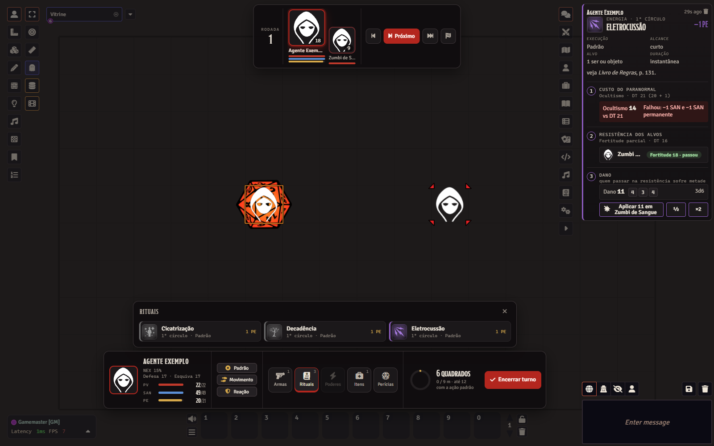
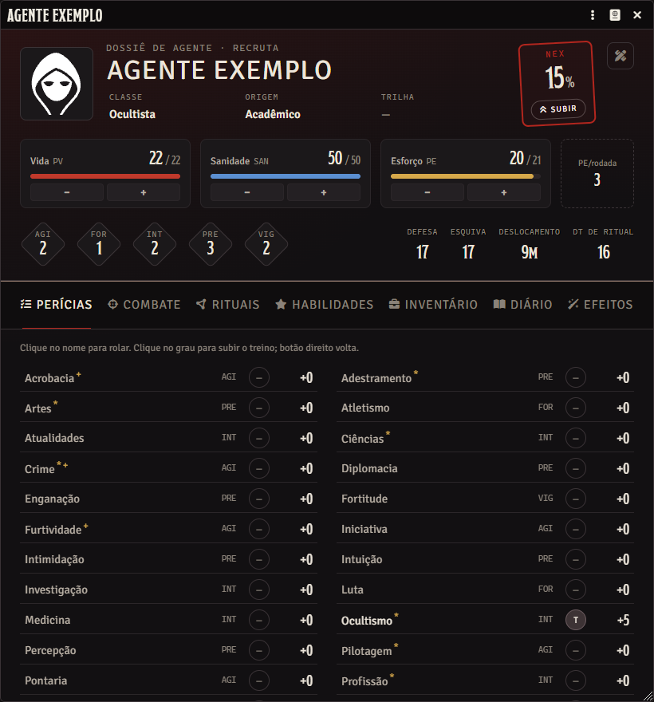
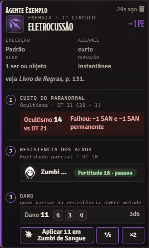
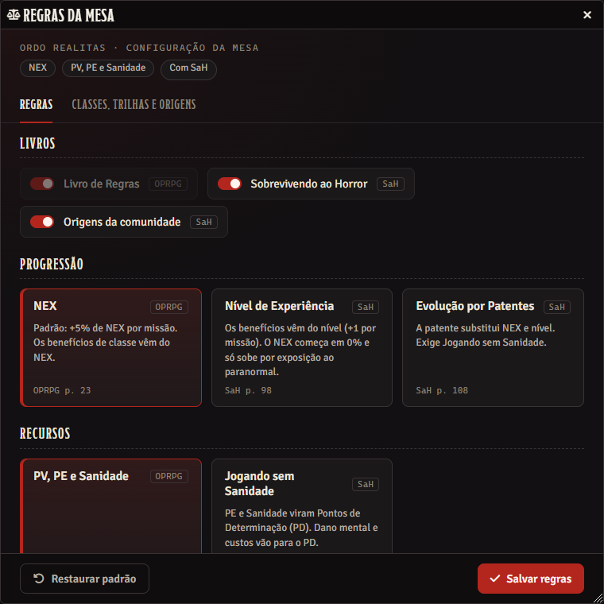
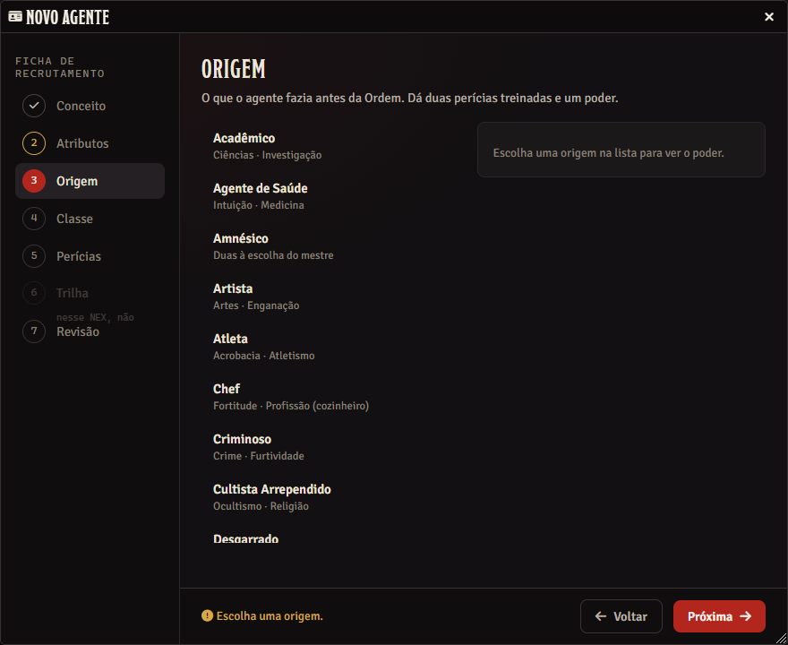

# Ordem Paranormal: Dossiê

Sistema não oficial para jogar **Ordem Paranormal RPG** no Foundry VTT (versão 13).



*Ordem Paranormal RPG foi criado por Rafael Lange (Cellbit) e publicado pela Jambô Editora. Este sistema é
um projeto de fã, sem vínculo com eles. Ele não traz os textos dos livros: as descrições de rituais, poderes,
habilidades, origens e itens apontam para a página do livro. Para jogar, tenha os livros.*

## Instalação

No Foundry, em **Sistemas de jogo → Instalar sistema**, cole o link do manifesto:

```
https://github.com/ULTRINH4/op-dossie/releases/latest/download/system.json
```

Ou baixe `op-dossie.zip` na [página de versões](https://github.com/ULTRINH4/op-dossie/releases) e descompacte
dentro de `Data/systems/op-dossie`.

Na primeira vez que o mestre abre um mundo, o sistema monta os compêndios (classes, origens, trilhas,
poderes, rituais, armas, proteções e equipamentos) com os números do Livro de Regras e do Sobrevivendo ao Horror.

## O que tem

- **Ficha de agente e de ameaça**, com perícias, graus, recursos (PV, PE, SAN ou PD), condições, inventário e diário.
- **Regras da Mesa** (só o mestre): livros ligados, progressão por NEX, Nível ou Patentes, jogar sem Sanidade,
  personagens de NEX 0% (Mundano ou Sobrevivente), regras opcionais e o que pode ser escolhido na criação.
- **Assistente de criação** que segue as Regras da Mesa, e **botão Subir** de nível com as escolhas de cada passo.
- **Cartões no chat em etapas**: ataque, dano, Custo do Paranormal e resistência dos alvos, com o resultado no
  próprio cartão e botões para aplicar o dano.
- **Faixa de turnos** no topo e **HUD de combate** no rodapé, com ações do turno, gavetas de armas, rituais,
  poderes, itens e perícias, e passos contra o deslocamento.
- **Regras opcionais** que funcionam: Lesões, Inspiração Resoluta, Loucura não letal, Ferimentos Debilitantes,
  Idade variada, Vida Além da Ordem (folgas) e Treinamento Especial.
- **Dado de uso** (regra da casa, opcional): munição, itens médicos e de gasto descem d12 → d10 → d8 → d6 → d4 quando
  a rolagem dá 1 ou 2. A munição rola no fim de cada combate; os demais itens, ao serem usados.
- **Efeitos visuais e sonoros** (com Sequencer e JB2A quando instalados; esperam os dados do Dice So Nice),
  e alucinações para quem está com a Sanidade baixa ou zerada.

## Imagens

| Ficha de agente | Cartão de ritual no chat |
| --- | --- |
|  |  |

| Regras da Mesa | Assistente de criação |
| --- | --- |
|  |  |

## Créditos

- Ordem Paranormal RPG: Rafael Lange (Cellbit), Jambô Editora.
- Efeitos sonoros: obras em domínio público (CC0), listadas em `sounds/CREDITS.md`.
- Ícones de itens, rituais e origens: desenhados para este sistema.

## Licença

Código sob licença MIT (veja `LICENSE`). Problemas e sugestões: [issues](https://github.com/ULTRINH4/op-dossie/issues).
